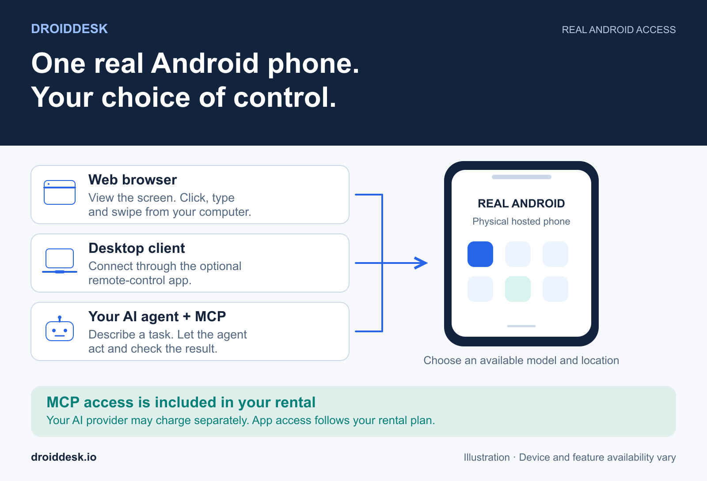
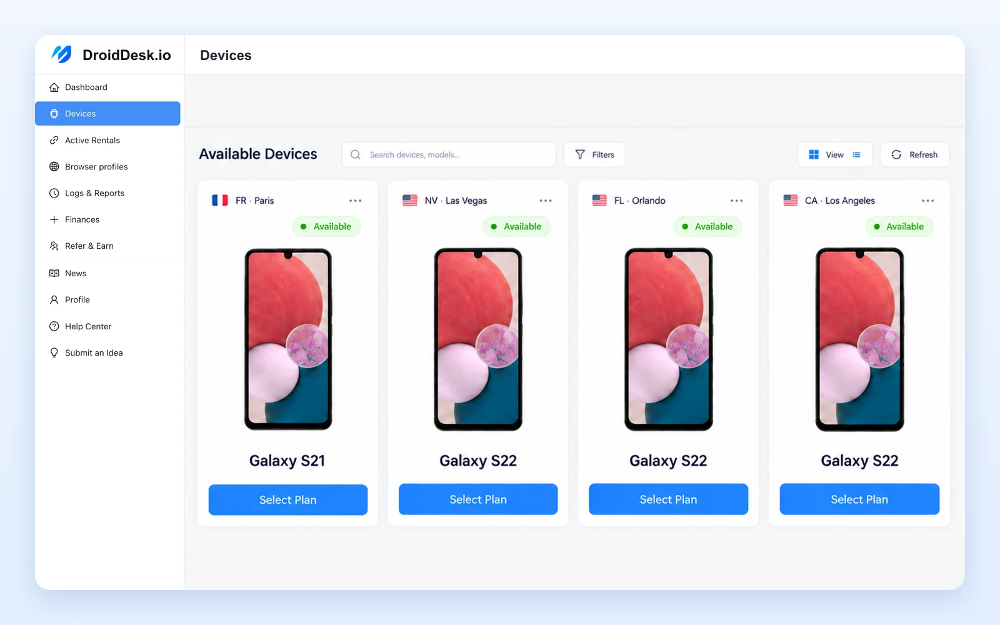
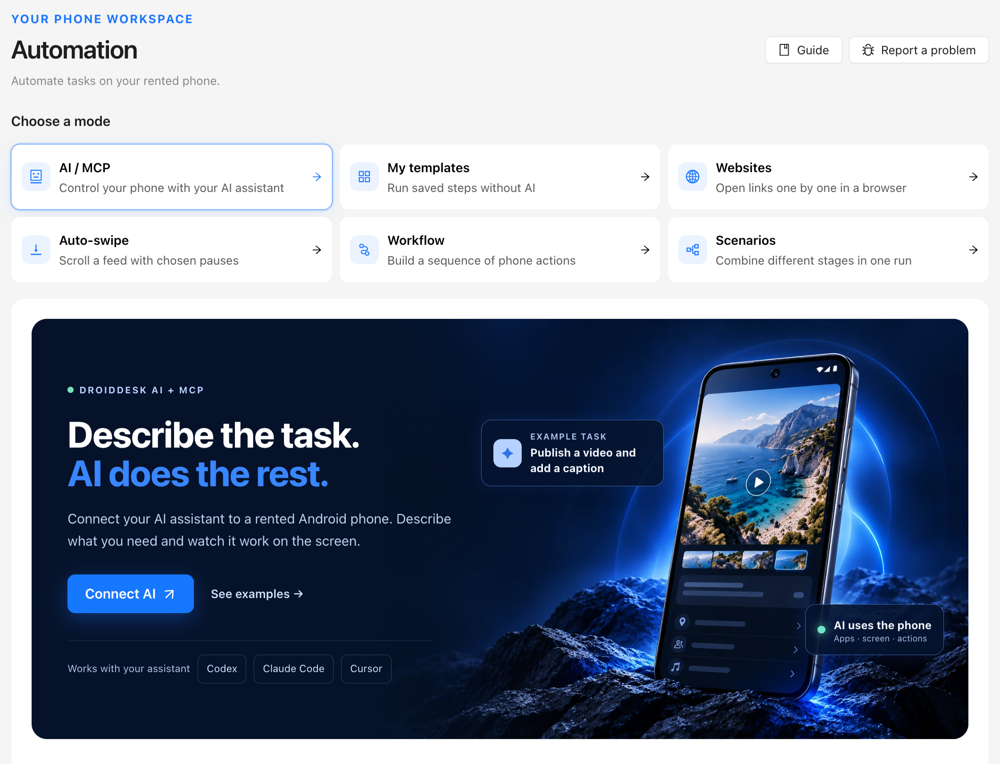
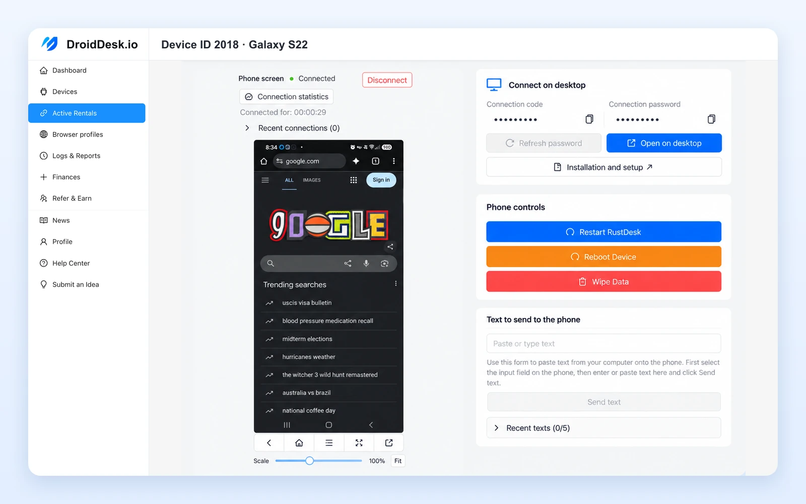
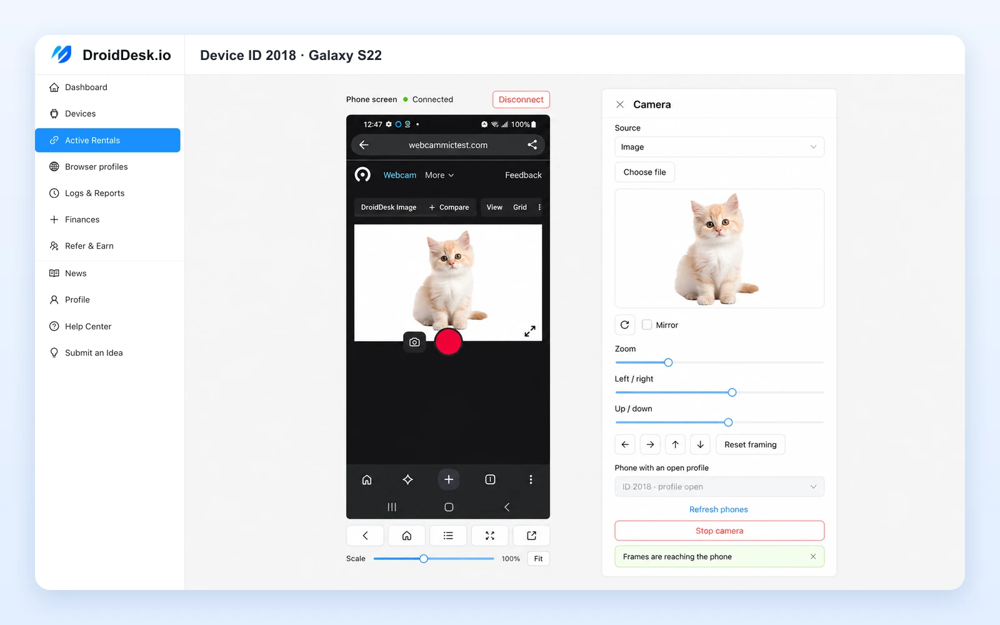

# DroidDesk Cloud Phone Rental and AI Control on Real Android Devices

[DroidDesk](https://droiddesk.io/) lets you rent a real Android phone online and use it remotely. Choose an available handset, location and rental period, then control the device from your computer. The physical phone stays with its host while you work with its screen over the internet.

You can also connect your own AI agent through **DroidDesk MCP**. Describe a task, let the agent interact with the phone, and ask it to check the result. **MCP access is included in your phone rental.** Your AI provider may charge separately.

[Browse phones](https://rent.droiddesk.io/) · [Compare rental plans](https://droiddesk.io/plans) · [Connect your AI agent](articles/control-android-phone-with-ai.md)

## What is a DroidDesk cloud phone

DroidDesk provides cloud-style access to physical Android smartphones. Your session runs on a hosted handset with its own hardware. This makes it a real device cloud for work that needs an actual Android environment.

The device listing helps you choose a model, location and network connection. Depending on the phone, its connection may use mobile data or residential Wi-Fi. Check the current catalog for availability and supported features. [About DroidDesk](https://droiddesk.io/help/what-is-droiddesk).

*Choose a device by model and location, then select a rental plan. Check the live catalog for current availability.*

## Control an Android phone with your AI agent

DroidDesk MCP connects a compatible AI assistant to the phones you authorize. The assistant can inspect the screen, open apps and websites, tap controls, type text, scroll, and check what happened after an action.

*Open AI / MCP in the phone’s automation area to connect your assistant.*

For example, you can ask:

> On my selected DroidDesk phone, open droiddesk.io and find the weekly rental plan. Tell me the price shown and take a screenshot. Do not place an order.

That is a prompt to try after connecting your agent. You can watch the device through your remote session while it works.

The MCP server is hosted by DroidDesk. You create an access key in your dashboard and connect an AI client that supports remote MCP over HTTP with Bearer authentication. The [setup guide](articles/control-android-phone-with-ai.md) covers Codex, Claude Code and Cursor.

Access follows your key permissions and active rental. Available actions also depend on the phone, plan and account configuration. Start with one device and a clearly described task.

## Remote Android access and browser tools

The web interface lets you view the phone and control it with your mouse and keyboard. An optional desktop client provides another way to connect. A browser-only rental limits the applications you can use on the phone; it does not mean that you must use a particular connection method.

*Control a rented Android phone from your computer, with the device screen and text input tools in one view.*

### Browser profiles

DroidDesk Browser profiles keep browser data and settings together. They support cookies, language, time zone and optional HTTP or SOCKS5 proxies. Save and close a profile successfully before reopening it on another compatible phone. A saved browser profile does not preserve data from other Android apps.

### Virtual camera in DroidDesk Browser

For supported websites in DroidDesk Browser, the virtual camera can use an image, video or computer camera as its source. This feature applies to the browser, rather than every Android app. See the [web app guide](https://droiddesk.io/help/droiddesk-web-app).

*Select a camera source and adjust its framing for a supported website in DroidDesk Browser.*

## Android automation and reusable templates

An AI agent can help you work through a sequence on your phone and save it as a private template, where this feature is available. Parameters let you supply values for later runs.

You can then launch the saved steps from **My Templates** in the phone’s automation area without involving the AI in each run. For example, a repeatable website check could use a page address and target text as parameters.

Templates execute saved steps. If an app changes its interface or requests verification, a run may need attention. Check the result before relying on it, and keep passwords and one-time codes out of the template definition.

For Auto-swipe with randomized pauses, repeatable workflows that reduce AI token usage, and registration flows with a connected SMS provider, read [Reduce AI Token Costs with DroidDesk Android Automation](articles/android-automation-templates-sms-verification.md).

## What you can do with a rented Android phone

### Real device testing

Use a hosted phone to check a mobile website or supported app on physical Android hardware. Give an agent a specific flow to inspect and ask it to capture the resulting screen. Choose a rental plan that permits the installation method your test needs.

### Mobile content and account work

Use your authorized accounts to prepare content, fill forms or handle messages in available apps. With MCP, you can ask the agent to prepare a caption or reply and show it to you before sending. File delivery depends on the AI client; DroidDesk can provide a private upload page when direct transfer is unavailable.

### A rented Android phone farm

For projects that need several devices, rent multiple phones instead of maintaining a rack yourself. Choose the models and regions that fit the work. Give the agent access to the intended rentals and identify which phone each task should use. [Learn about phone farm rental](https://droiddesk.io/use-cases/phone-farm).

### Work with a device in another region

Choose a phone hosted in an available location for regional mobile checks. Review its actual connection details before testing. A browser profile’s proxy or location preference does not physically move the handset. [Learn about network connections](https://droiddesk.io/help/how-internet-connection-works).

## Android phone rental pricing

Published starting prices checked on 2 November 2026:

| Rental period | Starting price per device | Base access |
| --- | --- | --- |
| 1 hour | $5 | Web browsers on the phone |
| 3 hours | $7 | Web browsers on the phone |
| 1 day | $15 | Standard apps and Google Play installation |
| 1 week | $60 | Google Play, manual APK installation, supported eSIM and system settings |
| 1 month | $180 | Same access as the weekly plan |

Device, location and add-ons affect the final price. eSIM needs compatible hardware. Check the [current plans](https://droiddesk.io/plans) and selected device before paying.

**DroidDesk MCP is included in the rental price.** Your chosen AI service and any connected third-party SMS provider have their own charges. MCP does not expand the application access included in your plan.

## How to rent an Android phone online

1. Open the [DroidDesk dashboard](https://rent.droiddesk.io/) and choose an available phone.
2. Select a rental period and the features your task requires.
3. Open the remote connection and check the phone’s screen.
4. To use AI control, create a scoped key under **AI / MCP** or **AI & API**, then follow the [MCP connection guide](articles/control-android-phone-with-ai.md).
5. Save any files you need before the rental ends.

## Frequently asked questions

### Is DroidDesk an Android emulator

No. DroidDesk rentals use physical Android phones. You access the handset remotely. [How DroidDesk works](https://droiddesk.io/).

### Can I control an Android phone from a PC

Yes. Open the remote web interface or use the desktop client. You can also connect a compatible AI agent through MCP. [Web access instructions](https://droiddesk.io/help/droiddesk-web-app).

### Can I install my own APK

Manual APK installation is included in the weekly and monthly plans. Full Access add-ons are listed for selected shorter plans. Check the [plan details](https://droiddesk.io/plans) for your rental.

### Do I need to install an MCP server locally

No. DroidDesk hosts the server. Configure the remote connection in your AI client with your DroidDesk key. [Get started with MCP](articles/control-android-phone-with-ai.md).

### Can I keep app data after my rental ends

Rental cleanup removes installed apps, app and browser data, and files from the phone. Download anything you need before expiry. Separately saved DroidDesk Browser profiles have their own save workflow; they are not a backup of the entire phone. [Data after rental](https://droiddesk.io/help/data-after-rental-ends) · [Saving browser profiles](https://droiddesk.io/help/droiddesk-web-app).

### Can the AI complete every task by itself

Task completion depends on the app, permissions and screen state. Verification steps or changed interfaces may need your help. Ask the agent to check results, especially after a payment, publication or message.

## Start with one phone and one task

[Choose your Android phone](https://rent.droiddesk.io/), then [connect your AI agent](articles/control-android-phone-with-ai.md). For rental and device questions, use the [DroidDesk Help Center](https://droiddesk.io/help).
