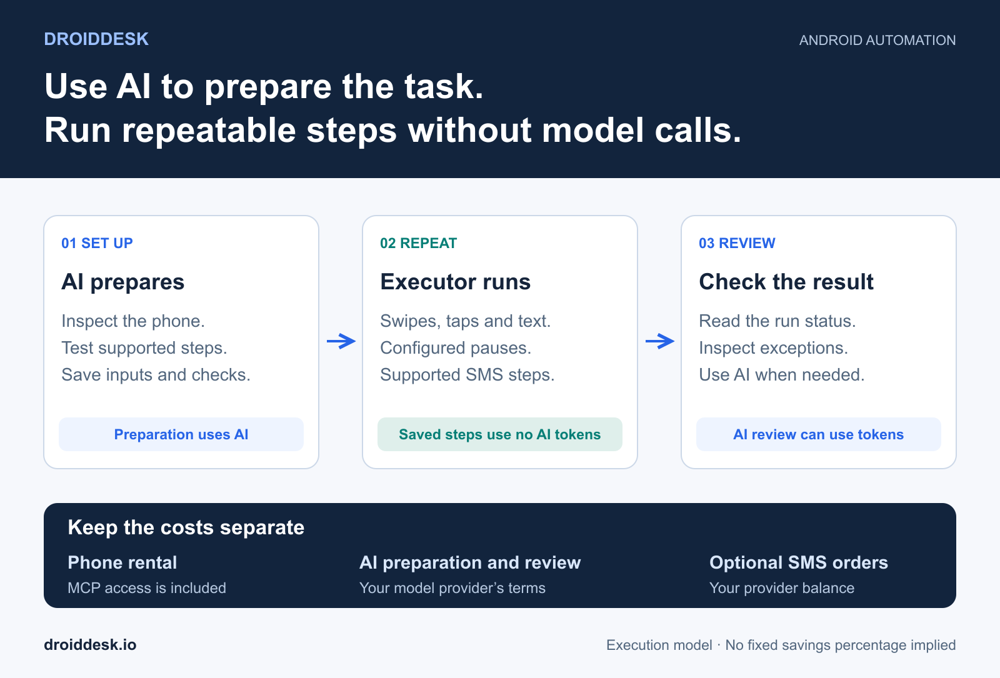
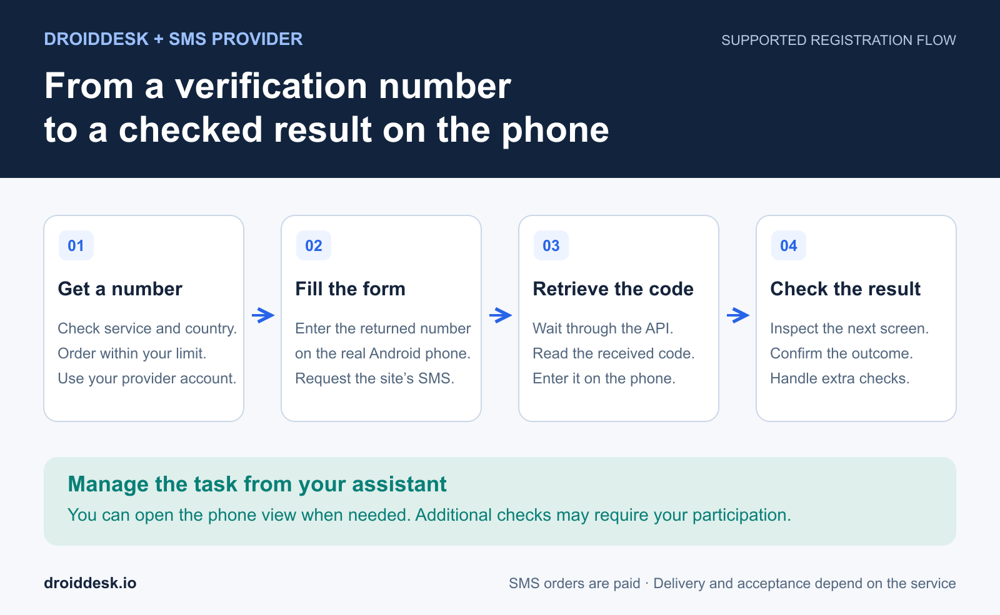

# Reduce AI Token Costs with DroidDesk Android Automation

Scrolling through a feed is repetitive. Working out how to complete an unfamiliar registration form takes judgment. With [DroidDesk](https://droiddesk.io/), you can give those jobs different execution methods: use an AI agent to understand the task, then let a configured automation or saved template perform the repeatable steps on a real Android phone.

**Auto-swipe and supported saved templates run without calling an AI model for each action.** Your agent can use tokens to create a template, launch it through MCP or review its result, while the saved sequence itself runs without AI. This makes long, predictable tasks a practical place to reduce model usage.

The same approach can include SMS verification. DroidDesk connects to your own SMS provider account so an authorized agent or supported template can request a number, retrieve a code and enter it on the phone. You can manage the task through your assistant without opening the remote phone screen for every step.

[Connect your AI agent](control-android-phone-with-ai.md) · [Explore Android phone rental](../README.md) · [Open DroidDesk](https://rent.droiddesk.io/)

## Where Android automation saves AI tokens

When an AI agent controls an unfamiliar screen, it may inspect the interface, choose an action, read the next screen and decide what to do next. That reasoning is useful when the task changes. Repeating it throughout a predictable sequence adds model requests that a saved procedure may not need.

DroidDesk supports several ways to execute work:

| Method | What performs the steps | Where AI usage remains |
| --- | --- | --- |
| Live AI control through MCP | Your AI agent decides the next action | Screen analysis, decisions and result review |
| Auto-swipe | A configured automation performs swipes and optional supported like actions | Any separate assistance you request to configure or review the task |
| Saved template | The executor follows saved actions with the supplied inputs | Creating, repairing or reviewing the template; an agent's launch request |
| Saved scenario built from supported templates | The executor runs the configured stages | Planning the scenario, launching it through an agent and interpreting results |

For example, an Auto-swipe run configured for 100 swipes can carry out those swipes without asking a language model what to do after each one. This describes how the run works; it is not a claim that every alternative uses exactly 100 model calls or that your bill falls by a fixed percentage.

**No AI tokens during execution does not mean the entire task is free.** Phone rental still applies. Your AI provider can charge for preparation, launch messages and follow-up analysis. SMS orders use your provider balance. [MCP access is included in the DroidDesk rental](control-android-phone-with-ai.md#what-does-droiddesk-mcp-cost).

Older workflows can include AI reasoning steps. Check which execution mode you are using before treating a saved workflow as a run without model calls.

## Instagram auto scroll with randomized pauses

The **Auto-swipe** mode in the phone's automation area lets you select an app, choose a scrolling direction and swipe type, set the number of swipes, and define the pause range. The executor chooses pauses within that range as it works.

A simple Instagram browsing session could use a limited number of downward swipes with pauses between 3 and 7 seconds. These are example settings, not a recommendation about account growth. Open the intended feed and confirm the starting screen before running the automation, so the swipes act on the right part of the app.

The routine follows its configuration without a model interpreting each post. Randomized timing changes the pauses; it does not guarantee reach, follower growth or protection from platform restrictions.

### Optional likes without a model decision for each post

For supported apps, including Instagram, Auto-swipe also offers an optional setting to like a configured share of videos. Those actions can run without an AI decision for each item. They are visible account actions, so enable them only for the account and activity you intend.

There is a useful distinction between a timing rule and a content decision. A configured share can determine how often to attempt a like. It cannot judge whether a particular video matches your brand, interests or approval criteria. If the instruction is “like only posts about this subject,” content analysis becomes part of the task and may use AI tokens.

For social media account work, the benefit is predictable execution of selected routine actions. Treat audience growth and engagement quality as separate outcomes to evaluate.

## Turn a repeated task into an Android automation template

An AI agent can help explore an app or website, perform a sequence and identify the controls that matter. Once the supported steps work, it can save them as a private template in DroidDesk. Inputs let you reuse the sequence with different values instead of rebuilding it each time.

A template can contain actions such as opening a URL or app, tapping a control, entering text, swiping and waiting for an expected screen. It can also include supported SMS steps. The final check matters: reaching the expected result gives the run a meaningful completion condition.

For example, ask your agent:

> On my selected DroidDesk phone, verify the steps for opening this page and completing the fields I specify. Save the supported sequence as a private template, with the page URL and field values as inputs. Stop before submission unless I authorize it. Add a check for the expected final screen.

The agent should build the template from controls it has actually observed. A plausible sequence of button names is not enough to establish that the automation works on your phone.

After saving it, you can provide the inputs in **My Templates** or ask a connected agent to launch the available template. Repeated execution follows the saved instructions. A changed interface, unexpected dialog or unsupported action may require the agent to inspect the screen and update the template.

Keep changing values in the inputs. Passwords, provider keys and SMS codes should not be hardcoded into a reusable template definition.

## Combine saved steps into a scenario

A saved scenario connects several supported template stages into a larger task. For example, one stage could open a form, another complete its supported verification flow, and a final stage check the resulting page. Use the appropriate inputs and verified template versions for each stage.

Through MCP, an AI client can list the saved scenarios available to its key, start a selected scenario and retrieve its status. The executor performs the stages without asking the model to decide every tap. You can return to the assistant for the result instead of watching each screen transition.

The built-in Auto-swipe controls and the templates exposed through MCP are separate entry points. Configure Auto-swipe in the dashboard; use your agent to launch saved templates and scenarios that its connection actually lists.

For long tasks, avoid requesting a fresh AI interpretation after every small step. Check completion and meaningful exceptions. If a run's outcome is unknown, inspect its status and the phone before starting another copy.

## Add SMS verification through a provider API

An SMS step involves two systems: the website or app running on the rented phone, and the provider supplying a verification number and its received message. The code can reach the automation through the provider API; you do not have to copy it manually from a separate dashboard.

DroidDesk supports connected **SMSPool** and **TextVerified** accounts where the integration is enabled. Add your provider credentials privately in DroidDesk, check the available service and country, and set a spending limit. The [SMSPool API documentation](https://www.smspool.net/article/how-to-use-the-smspool-api-0dd6eadf4c) describes ordering verifications and reading order status; the numbers and messages come from that provider service.

An authorized flow can:

1. Check offers for the requested service and country.
2. Order one eligible activation within the approved price limit.
3. Enter the returned phone number into the registration form.
4. Request the site's SMS and wait for the provider to receive it.
5. Retrieve the code, enter it and check the next screen.

Supported DroidDesk templates can include the number-order and code-wait steps inside the saved execution. The returned number and code become values for later steps. That lets the executor wait for SMS without repeatedly asking a language model whether a message has arrived.

The provider charges for the activation under its terms. Availability, delivery and acceptance of the number depend on the provider and destination service. The API number is separate from the rented phone's own mobile connection.

## Example of a Yahoo registration task through your assistant

Consider creating a Yahoo account for your own use. Yahoo's [sign-up instructions](https://help.yahoo.com/kb/account/SLN3546.html) describe entering account information and following the prompts to verify a mobile number. An agent connected to DroidDesk can work through supported screens on your rented Android phone while you communicate with it in chat.

Before starting, you need an active rental, a connected AI client with the relevant phone permissions, the account details to use, and an eligible SMS provider connection with sufficient balance. The provider must offer a suitable number for the service and country, and Yahoo must accept it.

An example instruction is:

> On my selected DroidDesk phone, help create my Yahoo account using the details I provide. Check whether my connected SMS provider has a suitable Yahoo number for the selected country. You may spend up to $2 on one activation. Retrieve the SMS code and complete the supported verification steps. Ask me when an approval or additional verification requires my participation. If registration is rejected, stop and explain the result. Confirm success only after checking the final account screen.

The $2 amount is an example spending cap, not a quoted SMS price. The agent should use the current offer and the permissions of your chosen client.

In a compatible flow, the agent opens registration on the phone, fills the supplied details, requests the approved number, enters the code returned by the provider and checks the outcome. **You can delegate those steps without opening the remote phone view or following the registration page yourself.** The phone still performs the website interaction, and you can open its screen whenever you want to inspect it.

SMS automation covers the supported phone-number verification step. Yahoo may also show a CAPTCHA, reject a number or require another check; its [registration troubleshooting guide](https://au.help.yahoo.com/kb/account/fix-problems-registering-yahoo-sln2632.html) describes issues beyond SMS entry. In those cases, the agent should report the obstacle or request your participation. An SMS API does not guarantee completion of every registration.

For an account you intend to keep, maintain recovery methods you can access later. An initial SMS activation does not establish ongoing access to that number. Yahoo uses recovery information in its [account recovery process](https://en-global.help.yahoo.com/kb/SLN2051.html).

### Reuse the verified registration steps

The first run may use AI to understand the form and handle its screens. A stable, supported portion can then become a template with account details supplied as inputs and SMS values obtained during execution.

You can reuse the verified procedure for an authorized task instead of paying for the model to rediscover every control. Keep the success check, handle exceptions explicitly, and update the template when the site changes. A saved registration sequence covers the flow it was built for; it does not automatically handle every new verification branch.

## Start with one repeatable task

Choose a routine with a clear starting screen, a limited set of supported actions and an observable result. Use Auto-swipe for configured feed scrolling, a private template for a verified sequence, or a saved scenario for several stages. Bring the AI back when the task needs judgment or the interface changes.

[Open DroidDesk](https://rent.droiddesk.io/) · [Set up DroidDesk MCP](control-android-phone-with-ai.md) · [Compare phone rental plans](https://droiddesk.io/plans)
