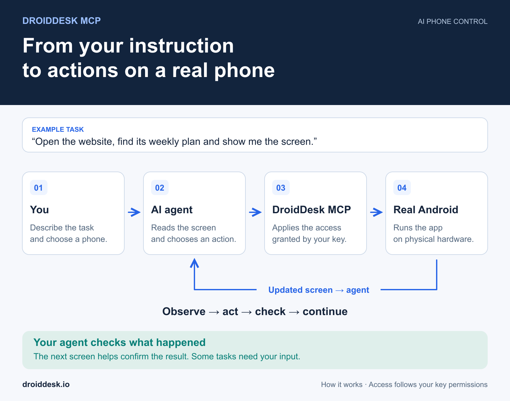
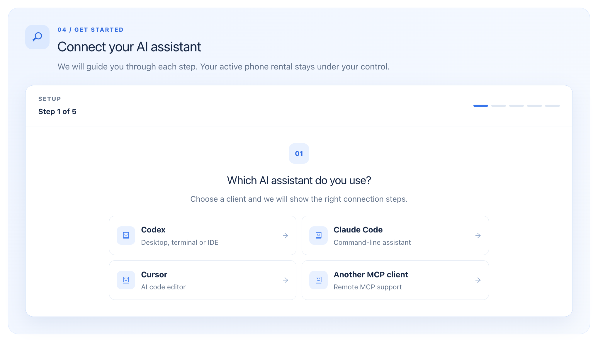

# Control a real Android phone with AI using DroidDesk MCP

*Updated 3 November 2026.*

An AI assistant can do more than explain where to tap. With **DroidDesk MCP**, it can inspect an authorized rented Android phone, open apps and websites, tap, type, scroll, and check the resulting screen. You describe the task in ordinary language while your chosen AI client uses DroidDesk’s tools to carry it out.

The phone runs on physical Android hardware, and the MCP server runs on DroidDesk’s side. **MCP access is included in your phone rental.** You pay your AI provider separately under its own terms.

Connect your agent, work with apps and files, run website lists or Auto-swipe, save templates, and use scenarios, SMS and rental tools. For device options and rental plans, see the [DroidDesk overview](../README.md).

Jump to: [Client setup](#connect-your-ai-client) · [First task](#try-your-first-task) · [File uploads](#send-files-to-your-android-phone) · [Websites and Auto-swipe](#run-websites-and-auto-swipe-through-mcp) · [Templates](#save-a-working-sequence-as-a-private-template) · [Scenarios](#run-saved-scenarios) · [SMS and rentals](#sms-and-additional-rentals) · [Tool reference](#droiddesk-mcp-tool-reference).



## How the DroidDesk Android MCP server works

MCP, or Model Context Protocol, connects an AI client to external tools. DroidDesk provides tools for phone access; the language model stays in the AI service you choose.

The interaction is a loop. The agent reads the current screen, chooses an action, sends it through DroidDesk MCP, and checks the updated screen before continuing. A request to tap a button is only one step: the next screen tells the agent whether the intended action worked.

Your key controls which rentals and actions the agent may access. Supported features depend on your account, key permissions, client, device and rental plan. Start by asking which DroidDesk tools the connection actually exposes. Reconnect the MCP server or start a new session if a newly released tool is missing.

## What your AI agent can do

| Task | Example request |
| --- | --- |
| Inspect a device | “Show the phones available to this connection, then describe the selected phone’s screen.” |
| Navigate a website | “Open this URL, find the pricing section and capture the displayed plan.” |
| Work in an app | “Open the selected app and find its language setting. Show me the current value.” |
| Prepare content | “Use my video and draft an English caption. Show me the caption before publishing.” |
| Fill a form | “Enter the details I provide and stop before submission.” |
| Repeat a workflow | “Verify these steps, then save them as a private template with parameters.” |
| Browse a website list | “Visit these three sites in order, with the time and pauses I specify.” |
| Run a saved scenario | “Show my scenarios, run the selected one and report each stage’s result.” |
| Find a phone | “Show available phones in the requested city and network. Do not rent one yet.” |

These are example requests to try on a suitably configured phone. Apps may ask for verification or show screens the agent cannot complete without your help.

## Before you connect

You need a [DroidDesk account](https://rent.droiddesk.io/), a DroidDesk access key, and an AI client that supports remote MCP over **Streamable HTTP** with **Bearer authentication**. An active rental is required to operate a phone. Codex, Claude Code and Cursor have configuration options for this connection.

Create a separate DroidDesk access key for the assistant. This is different from your dashboard password or AI provider key. Add it to the client’s connection settings; do not send it as an ordinary chat message.

## Create a DroidDesk access key

1. Sign in to your dashboard and open the rented phone’s automation page.
2. Find **AI / MCP** and its connection wizard. You can also manage keys under **AI & API**.
3. Select your AI client and follow the connection wizard.
4. Name the key so you can recognize the client using it.
5. Choose access to a specific phone or to current and future rentals, depending on the available settings.
6. Give it viewing permission for inspection, or control permission for taps, typing and other actions.
7. Save the key when it is shown. The dashboard may later display only part of it. Revoke and replace a lost or exposed key.

If you want the agent to purchase additional rentals, enable that permission separately and set a maximum price per order where the option is available. An existing rental can be controlled without granting permission to buy another one.

## Connect your AI client



*Choose your AI client in the DroidDesk connection wizard to see its setup instructions.*

Use this connection information:

| Setting | Value |
| --- | --- |
| Server name | `droiddesk` |
| Transport | Streamable HTTP |
| URL | `https://api.mobirent.io/mcp` |
| Authentication header | `Authorization: Bearer YOUR_DROIDDESK_KEY` |

The server address uses the `api.mobirent.io` domain shown in the DroidDesk connection instructions. Opening it in a browser is not a connection test; use your MCP client.

### Codex

Make your key available to the process running Codex as `DROIDDESK_API_KEY`. In **zsh**, this prompts for the key without displaying what you type:

```zsh
read -rs 'DROIDDESK_API_KEY?DroidDesk API key: '
export DROIDDESK_API_KEY
printf '\n'
```

For **bash**, use:

```bash
read -rs -p 'DroidDesk API key: ' DROIDDESK_API_KEY
export DROIDDESK_API_KEY
printf '\n'
```

Then add the remote server:

```bash
codex mcp add droiddesk \
  --url https://api.mobirent.io/mcp \
  --bearer-token-env-var DROIDDESK_API_KEY
```

Check that the entry exists with `codex mcp list`. Alternatively, merge this entry into `~/.codex/config.toml`:

```toml
[mcp_servers.droiddesk]
url = "https://api.mobirent.io/mcp"
bearer_token_env_var = "DROIDDESK_API_KEY"
```

A variable set in a terminal is available to that terminal’s child processes. A desktop app launched from the operating system’s menu may not inherit it. Restart the client with the required environment and start a new session. See the [official Codex MCP documentation](https://developers.openai.com/codex/mcp).

### Claude Code

For an installed Claude Code client, add the HTTP server at user scope:

```bash
claude mcp add --transport http --scope user droiddesk \
  https://api.mobirent.io/mcp \
  --header "Authorization: Bearer YOUR_DROIDDESK_KEY"
```

Replace the placeholder privately. This form stores the header in the client configuration and may leave the entered command in shell history. Use your client’s supported secret-management options for ongoing use.

Check `claude mcp list`, then start a new conversation. These instructions are for **Claude Code**; other Claude apps can have different connection requirements. See [Claude Code MCP configuration](https://code.claude.com/docs/en/mcp).

### Cursor

Make `DROIDDESK_API_KEY` available to the Cursor process. Merge this entry into your global `~/.cursor/mcp.json`, preserving any existing servers:

```json
{
  "mcpServers": {
    "droiddesk": {
      "url": "https://api.mobirent.io/mcp",
      "headers": {
        "Authorization": "Bearer ${env:DROIDDESK_API_KEY}"
      }
    }
  }
}
```

Restart Cursor and check the MCP connection in its settings. Environment-variable interpolation keeps the key out of this file. The variable must be available to the app itself. See [Cursor’s MCP documentation](https://cursor.com/docs/mcp).

### Other clients

Use the same URL and Bearer header in a client that supports remote HTTP MCP. Compatibility needs a separate check if a client accepts only OAuth connections or only local servers over stdio.

## Try your first task

First, confirm the device scope:

> Show the DroidDesk tools available to this connection, then list my phones. Do not change anything on the devices.

Choose a phone from the returned list, then check its state:

> On the selected phone, check readiness, read the current screen and describe it. Do not tap anything yet.

For a first navigation task, try:

> On this phone, open https://droiddesk.io, find the weekly rental plan and tell me the price displayed. Take a screenshot of the plan. Do not place an order.

This exercise has a clear result you can check against the screen. You can keep the remote phone view open while the agent works. More detailed instructions help when several similar buttons, accounts or devices are available.

## Read screens and check device information

Choose a device from `list_phones` and identify it explicitly when several rentals are available. Its control identifier is different from a SIM number or a number ordered for SMS verification.

`get_screen` returns numbered elements and a `snapshot_id`. The agent should use the element number and snapshot from the same observation. If it receives `stale_snapshot`, it needs to read the screen again. `screenshot` provides an image that complements the structured elements, particularly when an app exposes little text.

The standard actions include opening apps and URLs, tapping, typing, vertical swipes and the Back, Home, Enter and Notifications keys. The current `swipe` tool does not support horizontal swipes. Use `list_apps` to check the apps allowed for the rental; installation on the device alone does not establish permission to use an app.

`phone_status` reports readiness, while `phone_capabilities` describes available actions. `phone_info` can return saved model, operator, network, IP, location, labels and rental details. Saved IP and location values can be outdated; they are not a live IP or GPS check. Ask for an on-device check and its source when current information matters.

If an action returns `unknown` or its response is lost, inspect `get_operation` and the current screen before repeating it. A command can have reached the phone even when its result did not reach the client.

## Send files to your Android phone

With `prepare_file_upload`, an agent can prepare a private upload for the selected phone. Direct transfer from a chat attachment depends on whether the AI client can access the file and send it over the network.

1. Attach the file and identify the destination phone.
2. Ask the agent to prepare the upload and transfer the file without placing its bytes in the chat.
3. If direct transfer is unavailable, open the private upload page supplied by DroidDesk and select the file yourself.
4. Check the result with `file_transfer_status`.
5. For photos and videos, check the intended app or gallery before using the file.

The current form accepts `.mp4`, `.mov`, `.jpg`, `.jpeg`, `.png`, `.webp`, `.pdf` and `.txt`, up to **100 MiB**. The upload preparation response supplies the current limits; use those if they change.

`delivered` means the delivery service has confirmed delivery. Where supported, `media_status=indexed` confirms Android MediaStore indexing. An app or gallery may refresh later, so indexing does not establish visibility in every app. Check the status and device before retrying a transfer with an unknown outcome.

> Transfer my attached video to the selected phone. If direct transfer is unavailable, give me the private upload page. After delivery, check whether the video appears in the gallery. Do not publish it.

Keep the upload page and token private, just as you would an access key.

## Use AI Android automation for content and forms

For a content task, specify the phone, app, source file and intended stopping point:

> On my selected phone, open the publishing app. Use my attached video and prepare an English caption. Show me the caption and preview before publishing.

Use the [file upload steps](#send-files-to-your-android-phone) to get the source onto the device. Specify the account, caption, cover and audience when they matter. If publication is authorized, ask the agent to check the resulting post.

For forms, comments and messages, state which information to use, the intended recipient or post, and the point at which the agent should stop for review. For example:

> Open the conversation with the contact I specify, read the latest messages and draft a polite reply. Show me the text before sending.

> Open the registration page, enter the details I provide and stop before confirmation. Tell me if SMS or another verification step is required.

The agent can act on the screens and messages available to its connection. A changed form, CAPTCHA or additional verification can require your participation.

## Run websites and Auto-swipe through MCP

The `run_automation_mode` tool starts **Websites** (`url_list`) or basic **Auto-swipe** (`auto_swipe`) without AI calls inside the run. Ask the assistant to check that the tool is available in its session before starting.

| Mode | What you can configure through MCP | Current limits |
| --- | --- | --- |
| Websites | A list of HTTP/HTTPS URLs, minimum and maximum time per site, pauses between sites and shuffle | Up to 100 URLs; time per site from 1 to 600 seconds; pauses from 0 to 300 seconds |
| Auto-swipe | An allowed app, vertical direction, swipe count and a fixed interval | From 1 to 1,000 swipes; interval from 500 to 300,000 milliseconds |

Website timing is approximate because page loading and scrolling take time. The current mode uses link depth zero: it does not follow nested links or invoke AI to explore them.

> On the selected phone, visit these three websites in order. Spend 10–20 seconds on each, with a 3–5 second pause between sites. Do not follow nested links. Report the run’s progress.

> On the selected phone, open an app from its allowed app list and scroll down 20 times at a fixed five-second interval. If I ask you to stop, request a stop and check the final status.

**MCP currently exposes the basic configuration.** Automatic likes, randomized swipe intervals and other advanced dashboard options are not parameters of this tool. Those options remain distinct from what you can launch through this MCP mode.

Both modes use a phone identifier and a fresh `idempotency_key` for a new run. Track progress with `get_template_run` and request a stop with `stop_template_run`; these modes share the template run history. A phone action already dispatched can finish after the stop request. Check the final status rather than treating the request itself as proof that execution has ended.

For clients that expose direct tool arguments, a two-swipe example is:

```json
{
  "phone": "PHONE_FROM_LIST_PHONES",
  "mode": "auto_swipe",
  "package": "PACKAGE_FROM_LIST_APPS",
  "direction": "down",
  "swipe_count": 2,
  "interval_ms": 500,
  "idempotency_key": "NEW_UNIQUE_KEY_FOR_THIS_RUN"
}
```

Replace the placeholders with an authorized phone, an allowed package and a new key. Reuse a key only when checking or retrying the identical request after a lost response. Inspect an unknown outcome before starting another run.

## Save a working sequence as a private template

After a sequence works on the phone, ask the agent to save it as a private template, if templates are available to your account:

> Save the verified steps as a private template. Make the page URL and target text parameters. Do not store passwords or one-time codes in the template definition.

Open **Templates → My Templates** in the phone’s automation area, supply the parameters and run the saved steps. The template can run without AI involvement. It follows its saved sequence, so interface changes, verification prompts or missing inputs may still require attention. Review its result after execution.

The current template schema supports `open_url`, `launch_app`, `tap`, `type_text`, `swipe`, `press_key` and `wait_for`. Version 2 adds `sms_order` and `sms_wait`. The final step must use `wait_for` to check the expected result. Passing schema validation establishes that the definition is structurally valid; test the sequence on the intended phone to establish that its controls and outcome match.

Use `list_templates`, `validate_template` and `save_template` to inspect and prepare definitions. `run_template` takes the template ID, exact version, phone, input values and an `idempotency_key`. Check results with `get_template_run`; request a stop with `stop_template_run`. Browser or profile choices in the dashboard do not automatically imply that the same fields exist in `run_template`—check the current client schema.

## Run saved scenarios

A scenario runs saved templates in a configured order. The dashboard builder can define stages, shared variables, error behavior and, for compatible stages, browser or profile settings.

Through MCP, use `list_scenarios` to inspect the available scenarios, versions and stages. `run_scenario` identifies the scenario, exact version and phone. Supply one object in `values` for each stage in order, including an empty object for a stage without inputs. Use `shared_values` for shared variables and `browser_profile_id` where the scenario and current tool schema support it.

> Find my saved website-checking scenario, inspect its required inputs and run it on the phone I select. Report the result of each stage. If the outcome is unknown, check the existing run instead of launching it again.

Use `get_scenario_run` for stage results and `stop_scenario_run` to request a stop. Give each new run a new `idempotency_key`; reserve reuse for the identical request.

The executor runs the supported stages without a model decision at each step. If the AI must choose what to do next, let one run finish and ask the assistant to select the next sequence. Do not assume that a saved scenario can pause internally for an interactive AI decision.

See [Android automation with fewer AI tokens](android-automation-templates-sms-verification.md) for Auto-swipe, scenarios built from saved templates, and an example of registration with SMS verification through a connected provider.

## What does DroidDesk MCP cost

**There is no separate charge for MCP access: it is included in your DroidDesk phone rental.** Your rental plan still determines which apps and installation methods are available.

Your chosen AI client or model provider may charge for its service. Optional SMS orders use your connected provider account and its balance. Check the [current rental plans](https://droiddesk.io/plans) before choosing a device.

Website lists, basic Auto-swipe and supported saved templates or scenarios execute without model calls inside their saved steps. The assistant’s preparation, launch messages and interpretation of results may still use tokens. An older workflow containing AI reasoning steps has different costs.

## SMS and additional rentals

### SMS verification

Connect your own **SMSPool** or **TextVerified** API key privately in DroidDesk’s automation settings, where the integration is available. Ask the agent to check offers for the required service and country, then authorize an activation within a maximum price.

`sms_offers` returns offers, `sms_order` purchases an activation, `sms_status` checks its status and received code, and `sms_cancel` requests cancellation. Use the same provider for the order, status and cancellation. The current default is SMSPool; select TextVerified explicitly when using it. Orders require a new `idempotency_key`, reused only for the identical request.

> Check offers from my connected SMS provider for Yahoo in the US. Show the price before ordering. Once I approve a price limit, order one activation, retrieve the code for my registration and check the final screen. If the order’s result is unknown, inspect the existing order first.

Template schema version 2 can include `sms_order` and `sms_wait` with a provider parameter. Supply changing values at runtime and keep codes out of the saved definition and public reports.

SMS availability, charges, cancellation and refunds follow the provider’s terms. Receiving a code does not prove that registration succeeded; check the destination service. CAPTCHA and other checks can still require your help.

### Find and rent a phone through your agent

The agent can search `list_available_phones` by available fields such as country, city, network, operator, model or label. If results continue, follow `next_offset` to inspect later pages. Catalog information and `phone_info` contain saved details; request a separate live check when current network information matters.

> Find available phones in the US with a 5G connection. Show their model, city, operator and one-hour price. Do not rent one yet.

To place an order, the key needs separate rental permission and a price limit. Specify the device, duration, add-ons and maximum total price. `rent_phone` accepts a `device_id`, a duration of `1h`, `3h`, `1d`, `1w` or `1m`, `max_price_cents`, a unique `idempotency_key` and supported add-on options. For example, 500 cents is a $5 spending cap, not a promise that a particular phone costs $5.

The order must fit both the key’s limit and the limit in the request. Availability, discounts and add-on prices are checked when ordering. Inspect `get_rental_order`, then confirm the rental appears in `list_phones` and is ready. If the outcome is unclear, check the existing order before placing another one.

## DroidDesk MCP tool reference

Tool availability depends on the account, key and client session. Use the schema shown by your client for exact arguments.

| Purpose | Tools |
| --- | --- |
| Start and choose a rental | `get_started`, `list_phones` |
| Inspect device and apps | `phone_status`, `phone_info`, `phone_capabilities`, `list_apps` |
| Read the screen | `get_screen`, `screenshot` |
| Operate the phone | `launch_app`, `open_url`, `tap`, `type_text`, `swipe`, `press_key`, `wait_for` |
| Check an individual operation | `get_operation` |
| Transfer a file | `prepare_file_upload`, `file_transfer_status` |
| Run Websites or Auto-swipe | `run_automation_mode`, `get_template_run`, `stop_template_run` |
| Create and run templates | `list_templates`, `validate_template`, `save_template`, `run_template`, `get_template_run`, `stop_template_run` |
| Run saved scenarios | `list_scenarios`, `run_scenario`, `get_scenario_run`, `stop_scenario_run` |
| Use SMS verification | `sms_offers`, `sms_order`, `sms_status`, `sms_cancel` |
| Search and rent a phone | `list_available_phones`, `rent_phone`, `get_rental_order` |

## Troubleshooting

| What you see | What to check |
| --- | --- |
| Server is missing | Confirm the URL, saved configuration and remote HTTP support. Restart the client. |
| Authorization error | Check that the key is active, the Bearer header is present and the client can access the environment variable. |
| No phones are listed | Confirm an active rental and that the key includes the intended device. |
| Phone is listed but actions fail | Check control permission, device readiness and plan access. |
| `device_busy` | Wait for the other task to finish, or request a normal stop and check its result. |
| `stale_snapshot` | Read the screen again and use an element from the new snapshot. |
| A control cannot be found | Inspect a screenshot and the current screen; the app’s interface or exposed elements may have changed. |
| A new MCP tool is missing | Reconnect the server or start a new session, then check account permissions. |
| Upload is unavailable | Use the private manual upload page if your client cannot transfer the file. |
| A delivered file is not visible | Check indexing status and the intended app; galleries can refresh later. |
| A template or scenario stops | Inspect the run and failing step, inputs and final screen. |
| No SMS offers appear | Check the connected provider, balance, service, country and current availability. |
| A rental cannot be ordered | Check separate rental permission, catalog availability, balance and both price limits. |
| A result is unknown | Inspect the relevant operation, order or run and the device before repeating the request. |
| CAPTCHA blocks the task | Request user participation; automatic completion on the phone is not guaranteed. |

## Frequently asked questions

### Does the AI run on the rented phone

The model runs in your chosen AI service. DroidDesk MCP gives that agent tools to interact with the phone.

### Can one connection access several phones

Yes, if those active rentals are included in the key’s scope. Identify the intended phone in each task.

### Does this require a local Android emulator

No. The task runs on your rented physical phone, and DroidDesk hosts the MCP server.

### Can the agent solve every CAPTCHA

Automatic completion is not guaranteed. A CAPTCHA integration elsewhere in the service does not establish that a solution can be reliably applied to an Android browser through MCP. A site may require your participation or other verification.

### Can I launch Auto-swipe from my AI client

Yes, when `run_automation_mode` is available to your connection. The current MCP mode uses an allowed app, vertical direction, swipe count and a fixed interval. Randomized swipe intervals and automatic likes are additional dashboard options, not parameters of this tool.

### Can a template run without AI

Supported saved steps execute without calls to a model. Preparing or changing the sequence, interpreting a result or handling an unexpected screen may still require AI or a person.

### Are browser profiles a backup of all my Android apps

No. Browser profiles store their own browser data and settings. Other app data and files on the rented phone follow the rental cleanup process. Save what you need before the session ends. [Browser profiles](https://droiddesk.io/help/droiddesk-web-app) · [Rental cleanup](https://droiddesk.io/help/data-after-rental-ends).

## Connect your first phone

Open the [DroidDesk dashboard](https://rent.droiddesk.io/), choose a rental suited to your task, and create an AI access key. Start by asking your agent to list the available phones and describe the selected screen.

[Explore DroidDesk and rental plans](../README.md) · [DroidDesk Help Center](https://droiddesk.io/help)
